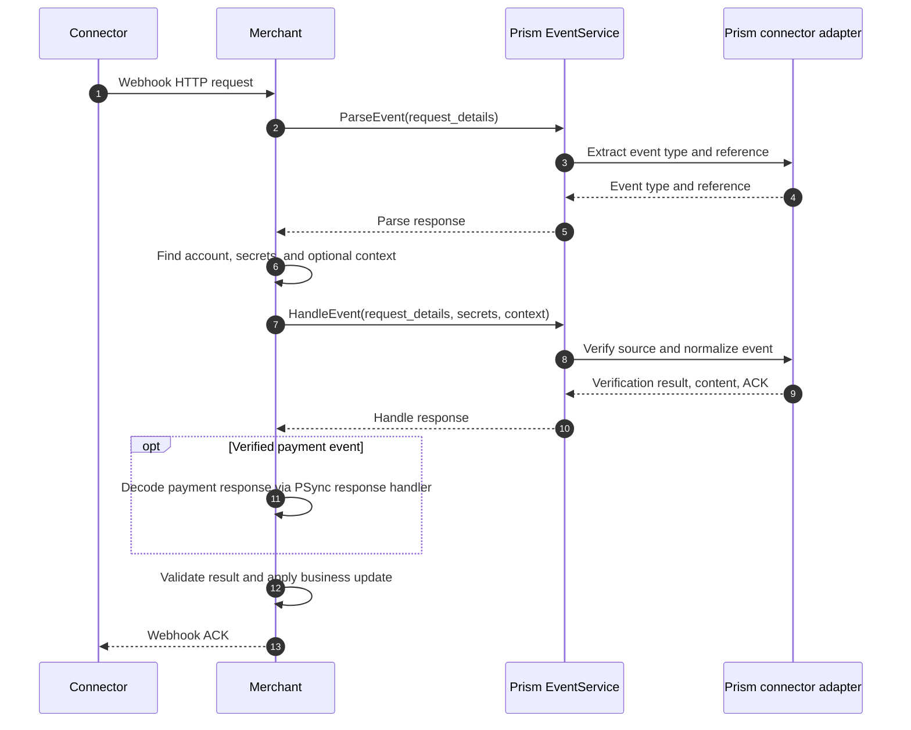

# Incoming webhooks with Prism

A connector sends a webhook to the **merchant**. The merchant passes the request to Prism's `EventService`, then uses the returned event to update its own records.

| Call | Request | Response | Purpose |
| --- | --- | --- | --- |
| **`ParseEvent`** | `request_details`: webhook method, URI, headers, query, and body. Connector identity comes through request metadata; no webhook secret is needed. | `event_type` and optional `reference` to the payment, refund, dispute, mandate, or payout. | Identify the event before the merchant selects its account and secrets. |
| **`HandleEvent`** | `request_details`; optional `webhook_secrets`, `access_token`, `event_context`, and `merchant_event_id`; connector auth/config in metadata. | `event_type`, normalized `event_content`, `source_verified`, optional `event_ack_response`, echoed `merchant_event_id`, and `supported_integrity_checks`. | Verify the source, produce typed content, and suggest the HTTP ACK. |

**Why two calls?** The parsed reference can identify the right merchant account. Prism is stateless, so the merchant supplies its secrets and any original payment context, such as `capture_method`, to `HandleEvent`.

`event_content` contains a payment, refund, dispute, or payout response. For a verified payment webhook, the merchant can decode the embedded payment response through its PSync **response handler locally**; this does not make a Prism `PaymentServiceGet` call. Prism may verify a webhook signature locally or use a connector verification API when that connector requires it. The merchant decides whether to trust or sync an unverified event before updating records.

## Adding a connector webhook

1. Implement [`IncomingWebhook`](../../../crates/types-traits/interfaces/src/connector_types.rs): `get_event_type` maps the event; `get_webhook_event_reference` fills every applicable ID below. Keep parent payment IDs distinct from the event's own ID.
2. Implement the matching `process_payment_webhook`, `process_refund_webhook`, `process_dispute_webhook`, or `process_payout_webhook` method. Map status and IDs into the normalized `HandleEvent` content. Override `get_webhook_api_response` for a connector-specific ACK and provide `sample_webhook_body` for probes.
3. For local signature checks, implement `IncomingWebhook::verify_webhook_source`. If verification calls the connector API, implement `VerifyWebhookSourceV2` **and** `ConnectorIntegrationV2<VerifyWebhookSource, ...>`, map the API result to `VerifyWebhookStatus`, and enable `webhook_source_verification_call.connectors_with_webhook_source_verification_call`. [PayPal](../../../crates/integrations/connector-integration/src/connectors/paypal.rs) is an example.
4. Test `ParseEvent` and `HandleEvent` with real-shaped success, failure, and invalid-signature payloads; assert the IDs, status, verification result, and ACK.

| Reference | Return every available ID in these fields |
| --- | --- |
| Payment | `connector_transaction_id`, `merchant_transaction_id` |
| Refund | `connector_refund_id`, `merchant_refund_id`, parent `connector_transaction_id`, `merchant_transaction_id` |
| Dispute | `connector_dispute_id`, parent `connector_transaction_id` |
| Mandate | `connector_mandate_id`, `merchant_transaction_id` |
| Payout | `connector_payout_id`, `merchant_payout_id` |

See the [EventService protocol](../../../crates/types-traits/grpc-api-types/proto/events.proto), [server implementation](../../../crates/grpc-server/grpc-server/src/server/events.rs), and [connector event processing](../../../crates/integrations/connector-integration/src/webhook_utils.rs).
