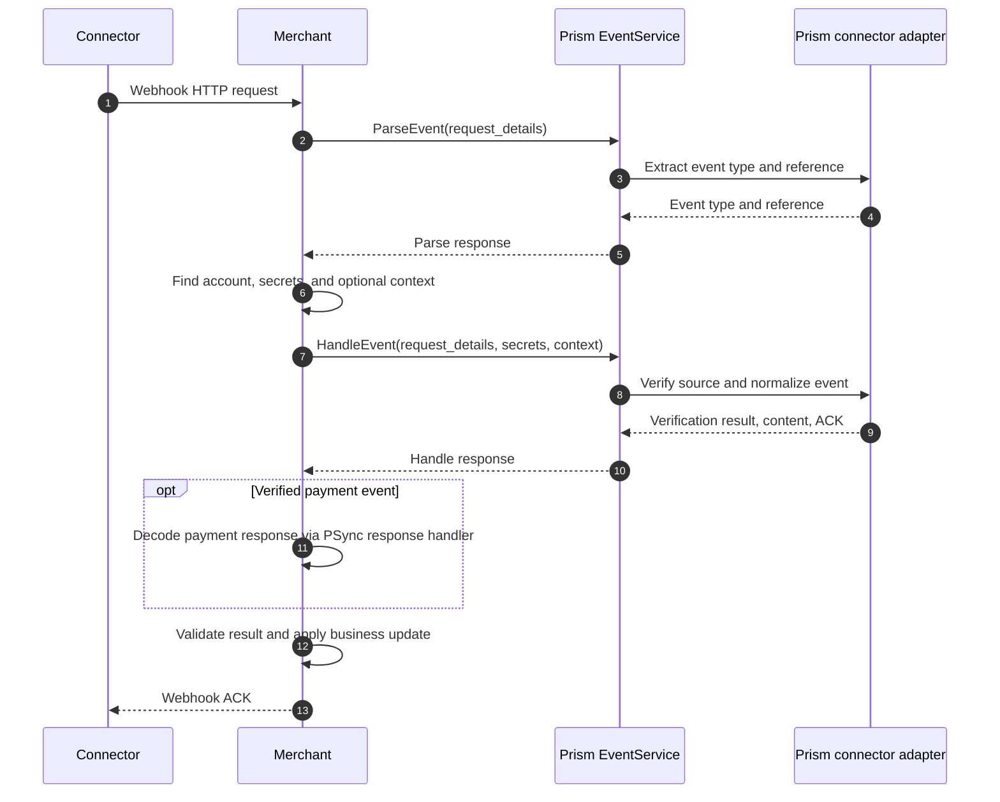

# Incoming webhooks with Prism

A connector sends a webhook to the **merchant**. The merchant passes the request to Prism's `EventService`, then uses the returned event to update its own records.

| Call | Request | Response | Purpose |
| --- | --- | --- | --- |
| **`ParseEvent`** | `request_details`: webhook method, URI, headers, query, and body. Connector identity comes through request metadata; no webhook secret is needed. | `event_type` and optional `reference` to the payment, refund, dispute, mandate, or payout. | Identify the event before the merchant selects its account and secrets. |
| **`HandleEvent`** | `request_details`; optional `webhook_secrets`, `access_token`, `event_context`, and `merchant_event_id`; connector auth/config in metadata. | `event_type`, normalized `event_content`, `source_verified`, optional `event_ack_response`, echoed `merchant_event_id`, and `supported_integrity_checks`. | Verify the source, produce typed content, and suggest the HTTP ACK. |

**Why two calls?** The parsed reference can identify the right merchant account. Prism is stateless, so the merchant supplies its secrets and any original payment context, such as `capture_method`, to `HandleEvent`.

`event_content` contains a payment, refund, dispute, or payout response. For a verified payment webhook, the merchant can decode the embedded payment response through its PSync **response handler locally**; this does not make a Prism `PaymentServiceGet` call. Prism may verify a webhook signature locally or use a connector verification API when that connector requires it. The merchant decides whether to trust or sync an unverified event before updating records.

## Adding a connector webhook

1. Implement [`WebhookCommon`](../../../crates/types-traits/interfaces/src/webhook_common.rs) in `webhook_connectors/<connector>.rs`, with payload types and event/reference mappings in `<connector>/transformers.rs`. Register the parser in [`webhook_connectors.rs`](../../../crates/integrations/connector-integration/src/webhook_connectors.rs). TrueLayer and Trustly have standalone implementations for both payment and payout metadata. Existing headers retain the legacy [`IncomingWebhook`](../../../crates/types-traits/interfaces/src/connector_types.rs) parsing path until the provider is enabled in `webhook_parse.migrated_connectors`. Keep parent payment IDs distinct from the event's own ID.
2. Implement the matching `process_payment_webhook`, `process_refund_webhook`, `process_dispute_webhook`, or `process_payout_webhook` method. Map status and IDs into the normalized `HandleEvent` content. Payment, refund, and dispute methods belong to `IncomingWebhook` on the payment connector. Implement payout normalization on `PayoutServiceTrait` in the payout connector and register it in `payout_connectors::get_webhook_connector`; retain the legacy payment payout method as a delegate. Provide `sample_webhook_body` on the existing payment connector for probes.
3. For local signature checks and provider-specific ACKs, implement `WebhookCommon::verify_webhook_source` and `WebhookCommon::get_webhook_api_response`. Keep legacy `IncomingWebhook` entry points available during migration. If verification calls the connector API, implement `VerifyWebhookSourceV2` **and** `ConnectorIntegrationV2<VerifyWebhookSource, ...>`, map the API result to `VerifyWebhookStatus`, and enable `webhook_source_verification_call.connectors_with_webhook_source_verification_call`. [PayPal](../../../crates/integrations/connector-integration/src/connectors/paypal.rs) is an example.
4. Test `ParseEvent` and `HandleEvent` with real-shaped success, failure, and invalid-signature payloads; assert the IDs, status, verification result, and ACK.

The migration enum selects either the common provider implementation or the
legacy payment connector for both ParseEvent and HandleEvent. Migrated common
operations include classification, local verification, ACK generation, and
integrity-check declarations. A resource enum then selects the registered payout
connector for migrated payout events; payment, refund, dispute, and other events
retain payment dispatch. TrueLayer and Trustly provide payout handlers, including
when HandleEvent receives gated payout metadata. The event classification decides
the resource family. Legacy requests retain their original dispatch and payout
entry points. Selected handler errors never retry through the other resource path.
The gRPC external source-verification integration retains a payment compatibility
context. Supporting a purely payout-only provider requires addressing that context.

Existing `IncomingWebhook` methods, the `WebhookParse` trait path, the original
ParseEvent resolver, and the original `process_webhook_event` helper remain
available. A failed source check still permits a response marked unverified;
no selected implementation is retried through another migration branch.

For rollout without an HS change, set `CS__WEBHOOK_PARSE__MIGRATED_CONNECTORS="trustly,truelayer"`.
Requests using existing connector metadata then select the standalone parser for
listed providers; an empty list keeps legacy parsing. Alternatively, incoming webhook calls
accept `x-webhook-connector` to explicitly select a standalone parser, overriding
legacy identity headers. Typed connector configuration must match that provider.
A shared resolver returns either webhook or payment connector data; callers
match that data to call the common trait or the legacy payment methods.
Explicit or configured migration to an unavailable parser returns an error;
parsing failures never retry the legacy implementation. The native FFI handler
honors the same rollout environment variable.

| Reference | Return every available ID in these fields |
| --- | --- |
| Payment | `connector_transaction_id`, `merchant_transaction_id` |
| Refund | `connector_refund_id`, `merchant_refund_id`, parent `connector_transaction_id`, `merchant_transaction_id` |
| Dispute | `connector_dispute_id`, parent `connector_transaction_id` |
| Mandate | `connector_mandate_id`, `merchant_transaction_id` |
| Payout | `connector_payout_id`, `merchant_payout_id` |

See the [EventService protocol](../../../crates/types-traits/grpc-api-types/proto/events.proto), [server implementation](../../../crates/grpc-server/grpc-server/src/server/events.rs), and [connector event processing](../../../crates/integrations/connector-integration/src/webhook_utils.rs).
