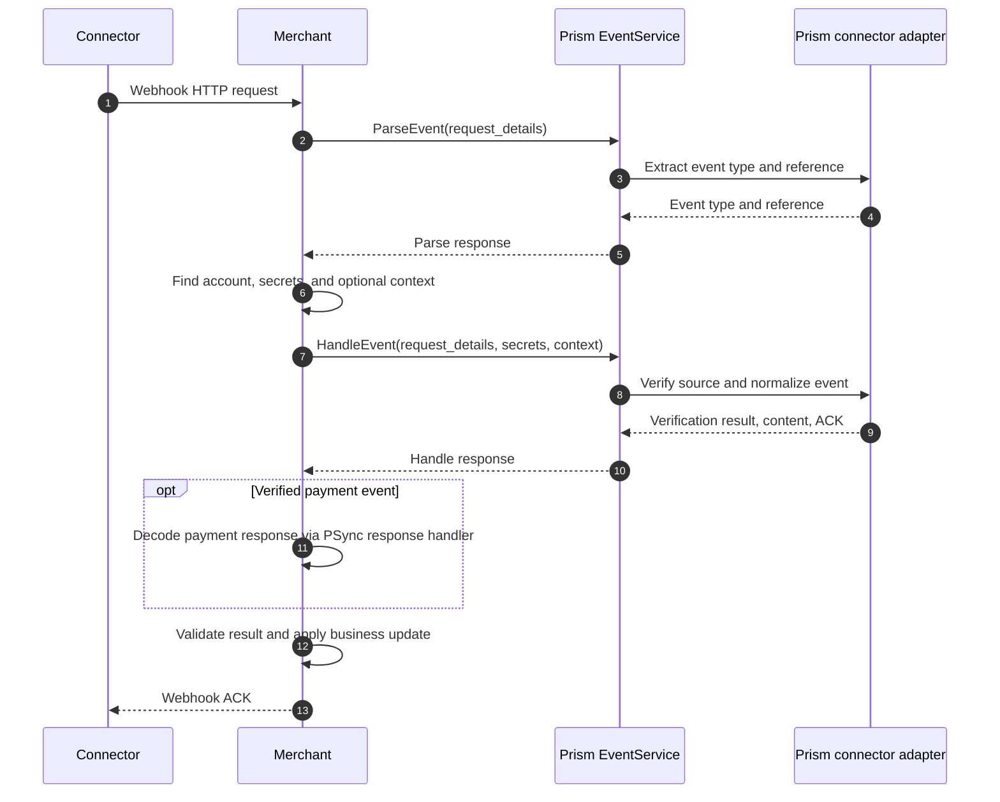

# Incoming webhooks with Prism

A connector sends a webhook to the **merchant**. The merchant passes the request to Prism's `EventService`, then uses the returned event to update its own records.

| Call | Request | Response | Purpose |
| --- | --- | --- | --- |
| **`ParseEvent`** | `request_details`: webhook method, URI, headers, query, and body. Connector identity comes through request metadata; no webhook secret is needed. | `event_type` and optional `reference` to the payment, refund, dispute, mandate, or payout. | Identify the event before the merchant selects its account and secrets. |
| **`HandleEvent`** | `request_details`; optional `webhook_secrets`, `access_token`, `event_context`, and `merchant_event_id`; connector auth/config in metadata. | `event_type`, normalized `event_content`, `source_verified`, optional `event_ack_response`, echoed `merchant_event_id`, and `supported_integrity_checks`. | Verify the source, produce typed content, and suggest the HTTP ACK. |

**Why two calls?** The parsed reference can identify the right merchant account. Prism is stateless, so the merchant supplies its secrets and any original payment context, such as `capture_method`, to `HandleEvent`.

`event_content` contains a payment, refund, dispute, or payout response. For a verified payment webhook, the merchant can decode the embedded payment response through its PSync **response handler locally**; this does not make a Prism `PaymentServiceGet` call. Prism may verify a webhook signature locally or use a connector verification API when that connector requires it. The merchant decides whether to trust or sync an unverified event before updating records.

## Adding a connector webhook

The common framework is available, but no providers are registered or migrated.
Existing requests use their legacy payment connector's `IncomingWebhook` methods.
See the [framework guide](../../../crates/integrations/connector-integration/src/webhook_connectors/README.md)
for the registration points and migration steps.

1. Implement [`Webhook`](../../../crates/types-traits/interfaces/src/webhook.rs)
   in `webhook_connectors/<connector>.rs`, with shared payload types and mappings
   in `<connector>/transformers.rs`. Register supported connector variants in
   [`webhook_connectors.rs`](../../../crates/integrations/connector-integration/src/webhook_connectors.rs).
2. Keep payment, refund, and dispute normalization on `IncomingWebhook`. For payout
   normalization, implement `PayoutServiceTrait::process_payout_webhook` in the
   payout connector and register it in `payout_connectors::get_webhook_connector`.
   Keep legacy entry points when migrating an existing provider.
3. Implement common classification, local verification, ACKs, and integrity
   declarations as appropriate. Classification in HandleEvent can override
   `get_event_type` without requiring ParseEvent's resource references. External
   gRPC verification retains its existing payment integration and compatibility
   context; native FFI retains local verification only.
4. Test parse and handle calls with success, failure, malformed, and invalid-signature
   payloads before enabling the registered provider in `webhook_parse.migrated_connectors`.

The shared resolver returns a common or legacy payment migration enum. The rollout
list defaults to empty and uses the normal configuration loader, including
`CS__WEBHOOK_PARSE__MIGRATED_CONNECTORS`. An optional `x-webhook-connector` header
explicitly selects a common provider. It overrides legacy identity headers, while
supplied typed connector configuration must match the provider. Explicit or configured
selection of an unregistered provider returns an error; no providers are registered
in this framework-only change. Errors never retry another migration branch.

After classification, the resource resolver selects a registered payout handler
only for migrated payout events. Other cases retain payment dispatch. The original
`IncomingWebhook` methods, `WebhookParse` path, resolver name, and
`process_webhook_event` helper remain available. A failed source check retains the
existing behavior of returning content and an ACK marked unverified.

| Reference | Return every available ID in these fields |
| --- | --- |
| Payment | `connector_transaction_id`, `merchant_transaction_id` |
| Refund | `connector_refund_id`, `merchant_refund_id`, parent `connector_transaction_id`, `merchant_transaction_id` |
| Dispute | `connector_dispute_id`, parent `connector_transaction_id` |
| Mandate | `connector_mandate_id`, `merchant_transaction_id` |
| Payout | `connector_payout_id`, `merchant_payout_id` |

See the [EventService protocol](../../../crates/types-traits/grpc-api-types/proto/events.proto), [server implementation](../../../crates/grpc-server/grpc-server/src/server/events.rs), and [connector event processing](../../../crates/integrations/connector-integration/src/webhook_utils.rs).
