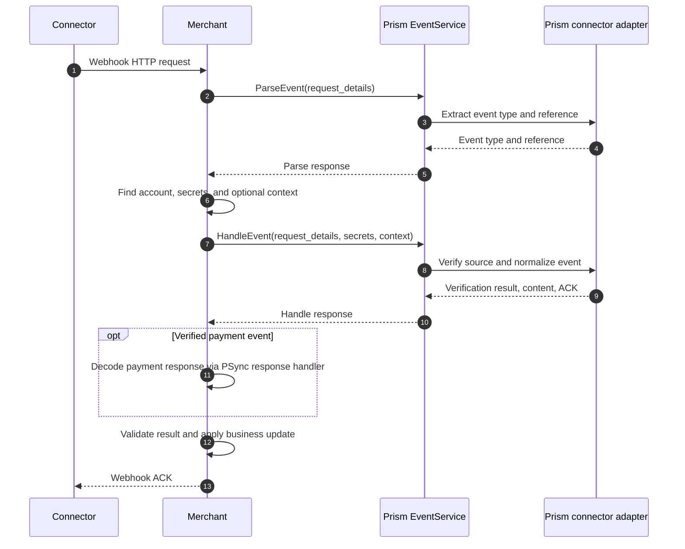

# Incoming webhooks with Prism

A connector sends a webhook to the **merchant**. The merchant passes the request to Prism's `EventService`, then uses the returned event to update its own records.

| Call | Request | Response | Purpose |
| --- | --- | --- | --- |
| **`ParseEvent`** | `request_details`: webhook method, URI, headers, query, and body. Connector identity comes through request metadata; no webhook secret is needed. | `event_type` and optional `reference` to the payment, refund, dispute, mandate, or payout. | Identify the event before the merchant selects its account and secrets. |
| **`HandleEvent`** | `request_details`; optional `webhook_secrets`, `access_token`, `event_context`, and `merchant_event_id`; connector auth/config in metadata. | `event_type`, normalized `event_content`, `source_verified`, optional `event_ack_response`, echoed `merchant_event_id`, and `supported_integrity_checks`. | Verify the source, produce typed content, and suggest the HTTP ACK. |

**Why two calls?** The parsed reference can identify the right merchant account. Prism is stateless, so the merchant supplies its secrets and any original payment context, such as `capture_method`, to `HandleEvent`.

`event_content` contains a payment, refund, dispute, or payout response. For a verified payment webhook, the merchant can decode the embedded payment response through its PSync **response handler locally**; this does not make a Prism `PaymentServiceGet` call. Prism may verify a webhook signature locally or use a connector verification API when that connector requires it. The merchant decides whether to trust or sync an unverified event before updating records.

## Adding a connector webhook

The provider webhook framework is available; no production provider is registered
or migrated in this PR. Existing requests retain their legacy `IncomingWebhook`
handling. See the [framework guide](../../../crates/integrations/connector-integration/src/webhook_connectors/README.md)
for registration and migration steps.

Implement [`Webhook`](../../../crates/types-traits/interfaces/src/webhook.rs) for
provider-level parsing, classification, local verification and ACKs. External gRPC
verification uses the provider's own static verification integration. Keep payment,
refund and dispute resource normalization on `IncomingWebhook`; implement payout
normalization on `PayoutServiceTrait` and register it in the payout webhook registry.

The resolver selects a legacy or provider branch. Legacy HandleEvent remains
unchanged. Provider HandleEvent classifies the event, resolves only the required
payment or payout resource handler, verifies the source, normalizes content, and
returns its ACK. Payout events never require a payment connector or fall back to
payment processing when their handler is absent. Native FFI keeps local verification
only and its existing empty integrity declarations.

`x-webhook-connector` is permanent provider identity. The rollout config and its
legacy/provider switch are temporary: remove them, compatibility aliases and legacy
handler branches once every supported connector migrates and compatibility checks
pass. Both registries are currently empty. Explicit or configured selection of an
unregistered implementation fails; rollout entries are validated at configuration
load. Selected handler errors never retry another path.

The rollout list defaults to empty in development/production TOML. gRPC supports
`CS__WEBHOOK_PARSE__MIGRATED_CONNECTORS`; FFI uses the TOML embedded when its SDK is
built, retaining its original environment-independent loading behavior. A failed
local source check preserves the existing unverified-content/ACK response semantics.

| Reference | Return every available ID in these fields |
| --- | --- |
| Payment | `connector_transaction_id`, `merchant_transaction_id` |
| Refund | `connector_refund_id`, `merchant_refund_id`, parent `connector_transaction_id`, `merchant_transaction_id` |
| Dispute | `connector_dispute_id`, parent `connector_transaction_id` |
| Mandate | `connector_mandate_id`, `merchant_transaction_id` |
| Payout | `connector_payout_id`, `merchant_payout_id` |

See the [EventService protocol](../../../crates/types-traits/grpc-api-types/proto/events.proto), [server implementation](../../../crates/grpc-server/grpc-server/src/server/events.rs), and [connector event processing](../../../crates/integrations/connector-integration/src/webhook_utils.rs).
